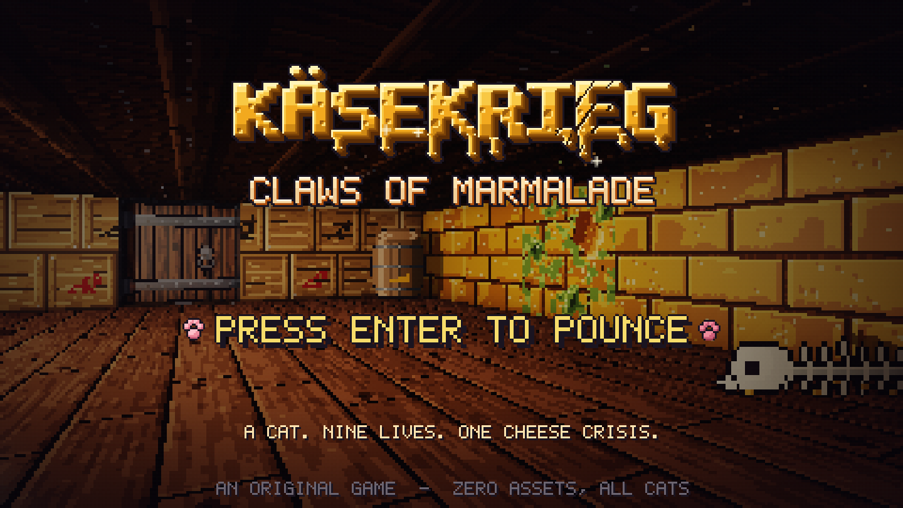
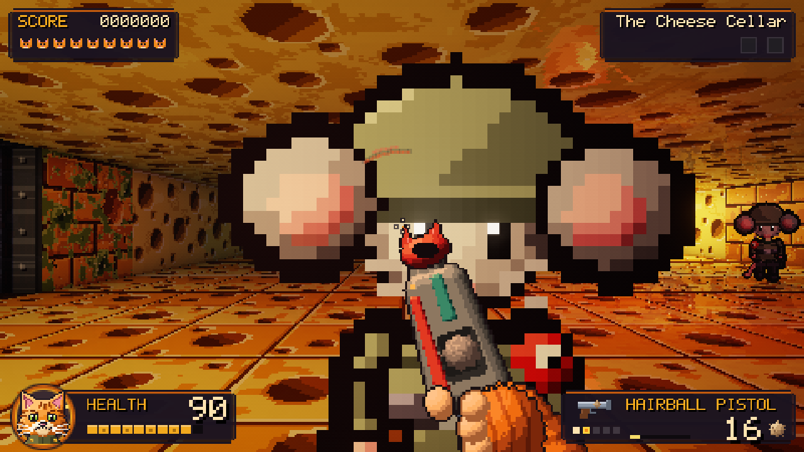
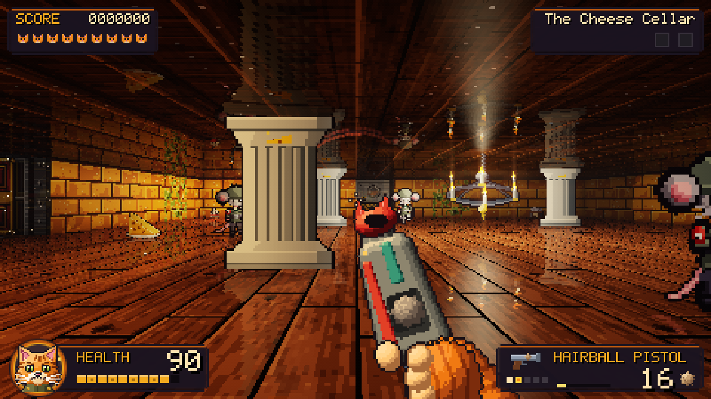
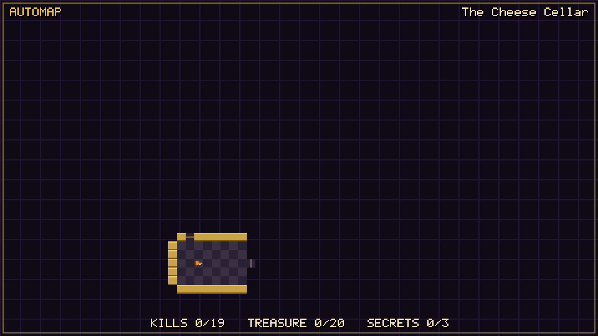

# KÄSEKRIEG: Claws of Marmalade

A first-person maze shooter in the style of Wolfenstein 3D, rendered with a WebGL2 ray tracer (lit, shadowed, reflective, sparkly) but still blocky. You play Major Marmalade, a big orange tabby with nine lives, fighting through six levels of Das Rattenreich: rats and mice in World War II-style uniforms, cheese-themed everything. The game is original; all art, levels and music are generated by code in this repo, and the enemy emblem is a cheese wedge, not real insignia.

| | |
|---|---|
|  |  |
| Title screen | E1M1, guard room |
|  |  |
| E1M1, Great Cellar | Automap |

## Play in a browser

Needs a browser with WebGL2 and Node (no npm install; the project has no dependencies outside `desktop/`).

```
node tools/serve.mjs          # http://127.0.0.1:4781/  (optional port argument)
```

Open the URL, click to capture the mouse.

### Controls

| Action | Keys |
|---|---|
| Move | W / S or Up / Down |
| Strafe | A / D |
| Turn | Mouse (after click to lock pointer), Left / Right arrows |
| Fire | Left mouse button, Ctrl |
| Run | Shift |
| Use (doors, switches, pushwalls) | Space or E |
| Select weapon | 1-5 (also numpad), Q cycles to the next owned weapon, mouse wheel |
| Meow (distraction noise) | M |
| Automap | Tab |
| Pause / back | Esc or P |
| Menus | Arrows or W/A/S/D, Enter or Space to accept, Esc or Backspace to go back |
| Fullscreen (desktop build) | F11 |

Gamepads are supported. Mouse sensitivity and volumes are in the Options menu. Weapons: Claws, Hairball Pistol, Purr-forator, Yarn Bomber, Der Rote Punkt. Skills: Kitten, House Cat, Alley Cat, Nine Lives Nightmare.

### URL parameters

Handled in `src/main.js` (`parseParams`):

| Parameter | Effect |
|---|---|
| `autostart=1` | Skip the title and start playing |
| `level=N` | Start level N (1-6) |
| `skill=N` | Skill 0-3 |
| `god=1` | God mode |
| `quality=auto\|...` | Force a render quality tier |
| `mute=1` | No audio |
| `demo=1` | Demo mode |
| `pos=x,y[,deg]` | Place the camera/player (used by the screenshot tool) |
| `seed=N` | Fixed random seed |

Example: `http://127.0.0.1:4781/index.html?autostart=1&level=3&skill=2&god=1`

## Desktop builds

Electron shell in `desktop/`, built natively on each OS. Outputs go to `dist/`. Each build runs the packaged app with `--smoke=<dir>`, which boots the real game, writes `smoke.json` and `smoke.png`, and exits 0 on success.

Note: `@electron/packager` hangs on Node 25+/26. `desktop/build.mjs` re-execs under an nvm Node 20/22/24 on Linux; the Mac and Windows scripts download a private Node 22.12 into their build folders.

| Platform | Command (run from Linux) | Output |
|---|---|---|
| Linux x64 | `node desktop/build.mjs --platform linux --arch x64` | `dist/Kaesekrieg-linux-x64/` |
| macOS arm64 | `desktop/scripts/build-macos.sh` (ssh to the Mac, env `MAC_HOST`, `NODE_VER`) | `dist/Kaesekrieg-darwin-arm64.zip` |
| Windows x64 | `desktop/scripts/build-windows.sh` (uses the win-devvm VM, env `VM_DIR`, `NODE_VER`) | `dist/Kaesekrieg-win32-x64.zip` |

Last recorded smoke results: Linux ok (software GL, about 29 fps, 0 errors); macOS ok (ANGLE/SwiftShader over ssh, about 22 fps); Windows ok (ANGLE/D3D11 software, about 34 fps). Software GL numbers say nothing about real GPU speed.

First-run notes:

- **Linux**: run `dist/Kaesekrieg-linux-x64/kaesekrieg.sh`. It starts the binary with `--no-sandbox`, because the unpackaged Electron `chrome-sandbox` is not setuid root. (Alternative: `sudo chown root chrome-sandbox && sudo chmod 4755 chrome-sandbox`, then run `Kaesekrieg` directly.) Headless: `xvfb-run -a dist/Kaesekrieg-linux-x64/kaesekrieg.sh --smoke=/some/dir`.
- **macOS**: the zip is ad-hoc signed only. Unzip, then right-click the app and choose Open, or run `xattr -dr com.apple.quarantine Kaesekrieg.app`.
- **Windows**: the zip is unsigned; SmartScreen may warn ("More info", then "Run anyway"). Unzip and run `Kaesekrieg.exe`.

More detail: `desktop/README.md`, `docs/swarm/reports/{desktop-shell,native-macos,native-windows}.md`.

## Tests and tools

```
node --test test/                                  # unit tests (173 passing, 0 failing)
node tools/validate-level.mjs src/levels/e1m1.js   # level rules + PNG preview
node tools/sheet.mjs <artModule> [--scale N]       # art contact sheet -> out/previews/
node tools/shot.mjs --url "/index.html?autostart=1&level=1" --out out/shots/x.png [--size 1280x720] [--wait-for "<js>"] [--keys "w:800"]
node tools/botplay.mjs ...                         # scripted bot that plays levels
node tools/swarm-plan.mjs                          # regenerate agent prompts + .tracker/plan.json from docs/swarm/SWARM.md
node tools/tracker/server.mjs                      # agent dashboard at http://127.0.0.1:4780/
node tools/track.mjs <agentId> start|progress|done|blocked|failed|note ...
```

`tools/shot.mjs` drives headless Chrome (`google-chrome --headless=new --no-sandbox --use-angle=vulkan --enable-features=Vulkan` gives WebGL2 on a GPU host).

## Repo map

```
index.html, style.css, src/main.js   app shell, main loop, state machine
src/core/       defs.js (canonical data), input, settings
src/art/        procedural pixel art (walls, flats, sprites, HUD, weapons) + atlas registry
src/render/     WebGL2 ray tracer, post-processing (bloom, star streaks, tonemap)
src/sim/        world (grid, doors, pathing), game/player/weapons, enemies, projectiles, effects
src/levels/     e1m1..e1m6 and the level index
src/ui/         bitmap font, HUD, automap, menus
src/audio/      WebAudio synth SFX (sfx.js) and tracker music engine (music.js; the song modules live in src/audio/songs/)
desktop/        Electron shell and native build scripts
tools/          server, screenshots, validators, bot, swarm planner, tracker
test/           node:test suites
docs/           CHECKPOINT.md, BUILD-SPEC.md, LEARNINGS.md, swarm/ (manifest, prompts, reports)
ARCHITECTURE.md the binding module contract
```

## How it was built

By a swarm of AI agents working from `ARCHITECTURE.md` and a manifest. To redo it elsewhere, read `docs/BUILD-SPEC.md`; lessons are in `docs/LEARNINGS.md`; per-agent reports are in `docs/swarm/reports/`.
